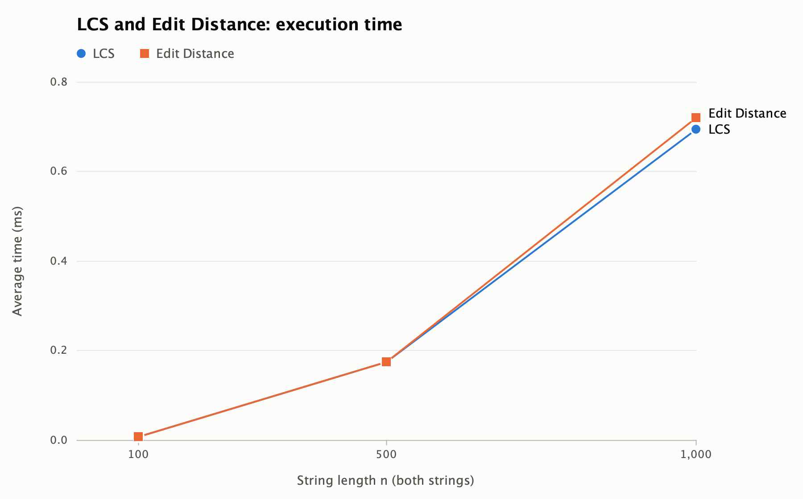
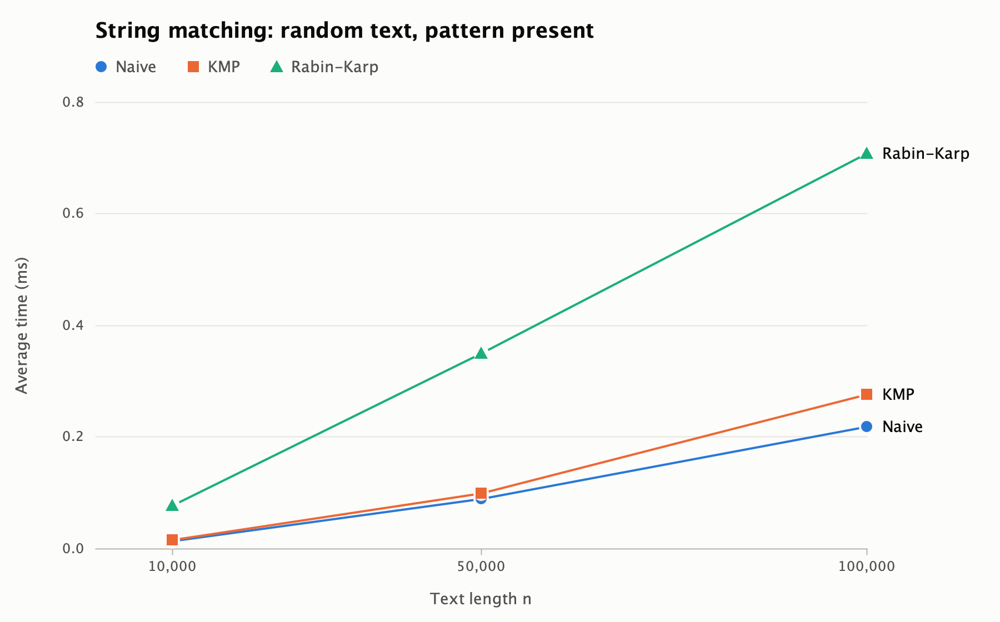
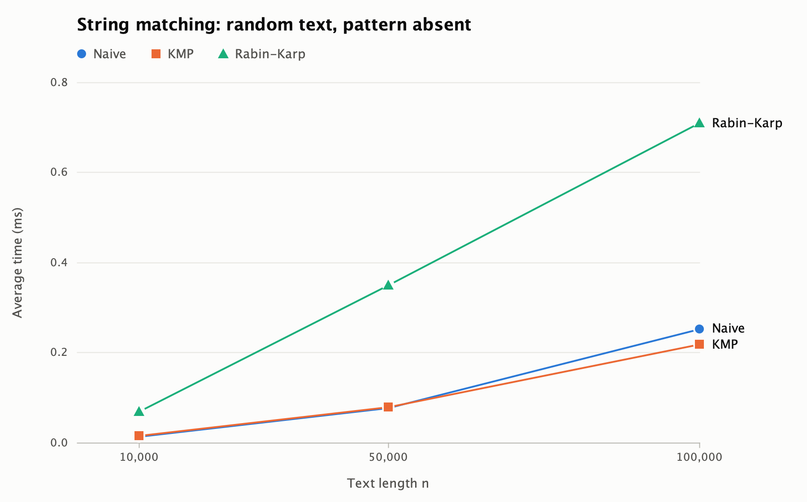
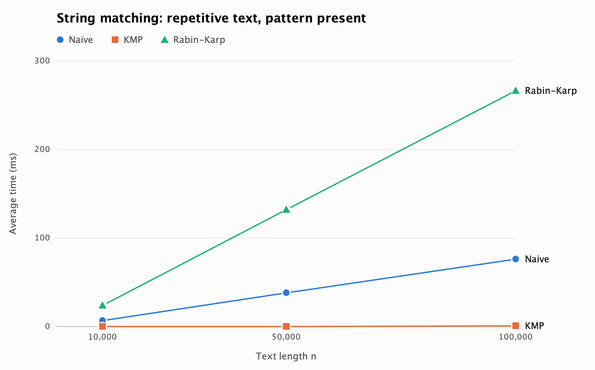
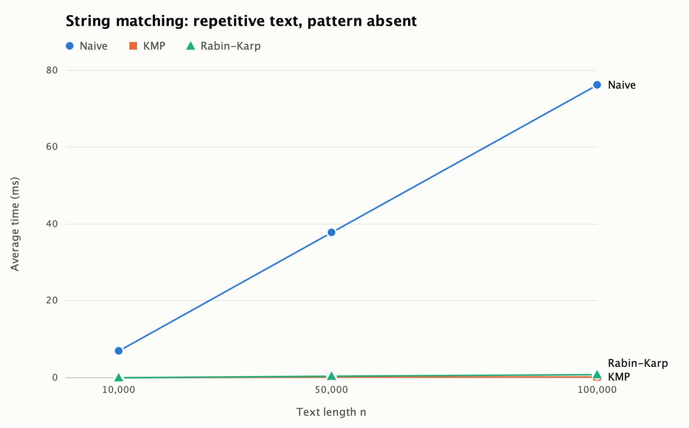
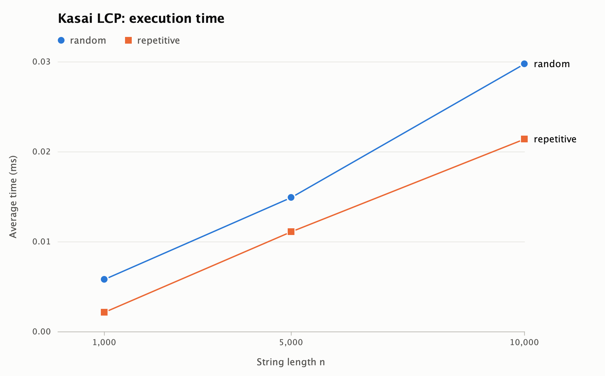

# Assignment 4: Text Analysis with Dynamic Programming and String Algorithms

This repository contains a Java application for text analysis. It implements two dynamic programming algorithms, three string matching algorithms, and Kasai's algorithm for the Longest Common Prefix (LCP) array. The project compares these algorithms by theoretical complexity and by experiments. This README is the full report.

## Repository Structure

| Path | Content |
|---|---|
| `src/dp` | LCS and Edit Distance |
| `src/matching` | Matcher interface, Naive, KMP, and Rabin-Karp |
| `src/suffix` | Kasai LCP algorithm and a simple suffix array builder |
| `src/util` | Operation counter |
| `src/app` | Small demo application |
| `src/experiment` | String generator, experiment runner, and plot generator |
| `test/tests` | Tests for all required algorithms |
| `results` | Experimental results in CSV tables |
| `results/plots` | Plots in PNG format |

## How to Compile and Run

The project needs only a JDK. No external library is used. The code was compiled and run with OpenJDK 25.0.2, and it also compiles with `--release 17`. Run all commands from the repository root. The first command uses a Unix shell, for example macOS, Linux, or Git Bash on Windows.

```bash
javac -d out $(find src test -name "*.java")
java -cp out tests.AllTests
java -cp out app.Main
java -cp out experiment.ExperimentRunner
java -cp out experiment.PlotGenerator
```

| Command | Purpose |
|---|---|
| `tests.AllTests` | Runs all tests. The exit code is 1 if a test fails. |
| `app.Main` | Shows all algorithms on short example strings. |
| `experiment.ExperimentRunner` | Runs all experiments (about 30 seconds) and writes CSV files to `results`. |
| `experiment.PlotGenerator` | Reads the CSV files and writes PNG plots to `results/plots`. |

## 1. Problem Description and Algorithm Overview

Text analysis often needs two kinds of answers. The first kind measures how similar two strings are. The second kind finds where a pattern occurs in a text. This project also studies the repeated structure of one string by using the LCP array.

In this report, `n` is the length of the first string or the text, and `m` is the length of the second string or the pattern.

### 1.1 Longest Common Subsequence (LCS)

LCS finds the length of the longest sequence of characters that appears in both strings in the same order. The characters do not need to be adjacent.

Let `L[i][j]` be the LCS length of the first `i` characters of `A` and the first `j` characters of `B`.

- Base cases: `L[i][0] = 0` and `L[0][j] = 0`.
- If `A[i-1] == B[j-1]`, then `L[i][j] = L[i-1][j-1] + 1`.
- Otherwise, `L[i][j] = max(L[i-1][j], L[i][j-1])`.

**Why the recurrence is correct.** An empty prefix has no common subsequence, so the base cases are correct. If the last characters are equal, an optimal solution can always use this pair: any optimal solution that does not use it can be changed to use it without becoming shorter. The rest of the solution is an optimal solution for the two shorter prefixes. If the last characters are different, they cannot both be the last matched pair. So at least one of them is not used, and the best answer is the better of the two cases that remove one character. The table is filled so that all smaller prefixes are solved first.

### 1.2 Edit Distance (Levenshtein Distance)

Edit Distance finds the minimum number of insertions, deletions, and substitutions that transform one string into another.

Let `D[i][j]` be the distance from the first `i` characters of `S` to the first `j` characters of `T`.

- Base cases: `D[i][0] = i` and `D[0][j] = j`.
- If `S[i-1] == T[j-1]`, then `D[i][j] = D[i-1][j-1]`.
- Otherwise, `D[i][j] = 1 + min(D[i-1][j], D[i][j-1], D[i-1][j-1])`. The three values represent deletion, insertion, and substitution.

**Why the recurrence is correct.** To transform a prefix into an empty string, we must delete all its characters. To transform an empty string into a prefix, we must insert all its characters. For other cases, consider the last operation on the last position of an optimal edit sequence. It is a deletion, an insertion, a substitution, or no operation when the characters are already equal. These cases cover all possibilities, and each case leaves a smaller subproblem that must also be solved optimally. If the characters are equal, keeping them is never worse than any other option, because the distances of neighbouring prefixes differ by at most 1.

### 1.3 Naive String Matching

The Naive algorithm tries every start position from `0` to `n - m`. At each position, it compares the characters from left to right and stops at the first mismatch. It is the baseline for comparison.

### 1.4 Knuth-Morris-Pratt (KMP)

KMP first builds the LPS table. The value `lps[i]` is the length of the longest proper prefix of `pattern[0..i]` that is also a suffix of this part of the pattern.

**How KMP avoids repeated comparisons.** During the search, the text index `i` never moves backward. When a mismatch happens after `j` matched characters, these `j` text characters are already known, because they are equal to the first `j` pattern characters. The value `lps[j-1]` shows the longest prefix of the pattern that already matches the end of this text part. So KMP continues from `j = lps[j-1]` and does not compare these characters again. After a full match, it continues from `lps[m-1]`, so overlapping occurrences are also found.

### 1.5 Rabin-Karp

Rabin-Karp compares a hash of the pattern with a hash of each text window of length `m`. The next window hash is computed from the previous one in constant time with a rolling hash:

`hash(next) = ((hash(current) - text[start] * base^(m-1)) * base + text[start+m]) mod q`

This project uses `base = 256` and the prime modulus `q = 1,000,000,007`. The calculations use `long`, so they do not overflow.

**How Rabin-Karp handles hash collisions.** Two different strings can have the same hash. For this reason, equal hashes are only a sign of a possible match. The algorithm then compares the window with the pattern character by character, and it reports the position only if all characters are equal. A window with an equal hash but different characters is a spurious hit. It costs extra time, but it cannot produce a wrong answer. One test uses the very small modulus 3 to force collisions and confirms that the result stays correct.

### 1.6 Kasai's LCP Algorithm

A suffix array stores the start positions of all suffixes of a string in sorted order. The LCP array stores the length of the common prefix of neighbouring suffixes in this order. In this project, `lcp[i]` is the LCP of the suffixes at `SA[i]` and `SA[i-1]`, and `lcp[0] = 0`. Large LCP values show repeated substrings in the string.

Kasai's algorithm uses the rank of each suffix and processes the suffixes in text order. If the suffix at position `i` has an LCP of `h` with its predecessor, then the suffix at position `i + 1` has an LCP of at least `h - 1` with its own predecessor. This holds because removing the first character from both suffixes keeps their order and leaves `h - 1` common characters. Therefore, the algorithm does not start the comparison from zero. It continues from `h - 1`.

Manual example for `banana`:

| i | SA[i] | Suffix | LCP with previous suffix |
|---|---|---|---|
| 0 | 5 | a | 0 (defined) |
| 1 | 3 | ana | 1 (a) |
| 2 | 1 | anana | 3 (ana) |
| 3 | 0 | banana | 0 |
| 4 | 4 | na | 0 |
| 5 | 2 | nana | 2 (na) |

## 2. Implementation Decisions and Assumptions

- **Empty pattern.** All three matchers return an empty list for an empty pattern. An empty pattern does not describe a meaningful text occurrence, so the project reports no occurrences.
- **Pattern longer than the text.** All three matchers return an empty list.
- **Overlapping occurrences.** All occurrences are reported, including overlapping ones. Indices are zero-based and sorted.
- **Null input.** Inputs are assumed not to be null.
- **DP tables.** LCS and Edit Distance use a full `(n+1) x (m+1)` table, as the assignment requires. Only the length or the distance is returned.
- **Characters.** Characters are compared exactly, so uppercase and lowercase letters are different.
- **Matcher interface.** The three matchers implement `StringMatcher`, so tests and experiments call them in the same way.
- **Suffix array.** Kasai's algorithm receives the suffix array as input. `SuffixArrayBuilder` sorts the suffixes with a simple comparison. It is only a helper for tests and experiments, and its time is not measured.
- **Library use.** All required algorithms are implemented in this project. The Java library is used only for collections, random data, sorting in the suffix array helper, files, plots, and timing.
- **Tests.** Maven and JUnit are not used, so the project can be built with `javac` only. The tests use a small class, `TestSupport`, built on the Java standard library.
- **Operation counters.** Algorithms receive an `OperationCounter`. It records character comparisons, DP cell updates, hash comparisons, and spurious hits.

## 3. Complexity Analysis

These are theoretical results. Measured execution times are given separately in Section 6. Here, `k` is the number of reported occurrences. The result list needs `O(k)` extra space, and it is not included in the auxiliary space column.

The bounds for the matchers apply when `1 <= m <= n`. If `m = 0` or `m > n`, all matchers return immediately in `O(1)` time.

| Algorithm | Main operation or recurrence | Best-case time | Worst-case time | Auxiliary space | Justification |
|---|---|---|---|---|---|
| LCS | `L[i][j] = L[i-1][j-1] + 1` if the characters match, otherwise `max(L[i-1][j], L[i][j-1])` | Θ(nm) | Θ(nm) | Θ(nm) | The two loops fill all `n x m` cells for every input. Each cell needs constant work. The table has `(n+1)(m+1)` cells. |
| Edit Distance | `D[i][j] = D[i-1][j-1]` if the characters match, otherwise `1 + min(D[i-1][j], D[i][j-1], D[i-1][j-1])` | Θ(nm) | Θ(nm) | Θ(nm) | The structure is the same as in LCS, with constant work for each of the `n x m` cells. |
| Naive matching | Compare the pattern with the text at each start position. No preprocessing. | Θ(n-m+1) | Θ((n-m+1)m), which is O(nm) | Θ(1) | Best case: every position stops after one comparison, so there are `n-m+1` comparisons. Worst case: each of the `n-m+1` positions needs all `m` comparisons. |
| KMP | Build `lps`, then move `i` forward and shift `j` with `j = lps[j-1]`. | Θ(n + m) | Θ(n + m) | Θ(m) | Preprocessing is Θ(m). In the search, `i` never decreases and `j` can decrease only as much as it has increased. So the search makes at most `2n` comparisons. |
| Rabin-Karp | Compare hashes, roll the hash, and verify characters when hashes are equal. | Θ(n + m) | Θ(nm) | Θ(1) | Preprocessing is Θ(m), and rolling the hash is Θ(1) per window. Each verification costs up to `m`. The expected time is Θ(n + m + mk) with a good hash. The worst case happens if most windows need verification. |
| Kasai LCP | Compute `rank`, then extend the common length `h`, and reduce it by at most 1 for the next suffix. | Θ(n) | Θ(n) | Θ(n) | `h` never exceeds `n`. It is reduced at most once per suffix and reset only for the first-ranked suffix, so the number of successful comparisons is `O(n)`. Each suffix has at most one failed comparison. The `rank` array needs `n` cells. |

**Preprocessing and search.**

| Algorithm | Preprocessing | Search (best) | Search (worst) |
|---|---|---|---|
| Naive | None | Θ(n-m+1) | Θ((n-m+1)m) |
| KMP | Θ(m) | Θ(n) | Θ(n) |
| Rabin-Karp | Θ(m) | Θ(n) | Θ(nm) |

**Expected and worst-case bounds of Rabin-Karp.** Rabin-Karp is the only required algorithm with different expected and worst-case bounds. With a good hash and a large modulus, a spurious hit has a probability of about `1/q` for each window. Then the character checks happen almost only at real occurrences, and the expected time is Θ(n + m + mk). When there are few occurrences, this is about Θ(n + m). The worst case is Θ(nm). It happens when most windows need full verification, for example when the text and the pattern contain only one repeated letter, or when many collisions happen.

**Space reduction.** LCS and Edit Distance could use `O(min(n, m))` space if only the last row is kept. The full table is used here because the assignment asks for a dynamic programming table.

## 4. Testing Strategy and Results

The tests are in `test/tests`. Each check compares an actual result with an expected result that was prepared by hand. Every string matching case runs Naive, KMP, and Rabin-Karp. Each matcher is compared with the expected list, and one more check confirms that all three lists are the same.

| Area | Test cases | Checks |
|---|---|---|
| LCS | Identical strings, completely different strings, first, second, and both strings empty, textbook example, non-contiguous subsequence, number of filled cells | 8 |
| Edit Distance | Identical strings, source empty, target empty, both empty, substitution only, insertion only, deletion only, mixed operations (`kitten` to `sitting`), symmetry, number of filled cells | 10 |
| String matching | Pattern at the beginning, middle, and end; multiple and overlapping occurrences; pattern absent; pattern longer than the text; empty pattern; empty text; empty text and pattern; pattern equal to the text; single character. Each case has four checks. | 52 |
| KMP and Rabin-Karp details | Known LPS table, correct answer under forced hash collisions, spurious hits really occur, agreement on 500 random inputs | 4 |
| Kasai LCP | `banana`, `abracadabra`, `aaaa`, one character, and an empty string, with manually verified suffix and LCP arrays. Comparison with direct LCP computation on 200 random strings. | 11 |

Result of `java -cp out tests.AllTests`:

```text
Passed: 85
Failed: 0
```

## 5. Experimental Setup, Input Sizes, and Timing Methodology

**Environment.** Apple M4 CPU, 16 GB memory, macOS (Darwin 24.6.0), and OpenJDK 25.0.2. The default JVM settings were used.

**Alphabet.** All generated strings use the alphabet `{a, b, c, d}`. The repetitive inputs use only `a` and `b` from the same alphabet.

**Random seed.** The random generator uses the fixed seed 42. Each experiment group starts a new generator with this seed.

| Experiment | Input sizes | Inputs |
|---|---|---|
| LCS | Two strings of length 100, 500, and 1,000 | Random strings |
| Edit Distance | Two strings of length 100, 500, and 1,000 | The same strings as LCS |
| String matching | Text lengths 10,000, 50,000, and 100,000 | The four scenarios below |
| Kasai LCP | Strings of length 1,000, 5,000, and 10,000 | Random and repetitive strings |

**String matching scenarios.** Naive, KMP, and Rabin-Karp use the same text and the same pattern in each comparison.

| Scenario | Text | Pattern | Pattern length | Purpose |
|---|---|---|---|---|
| `random_present` | Random | Copy of the text from position `n/2` | 20 | Required: pattern present |
| `random_absent` | Random | Random pattern, checked to be absent before timing | 20 | Required: pattern absent |
| `repetitive_present` | Only `a` | Only `a` | 1,000 | Additional: worst case for Naive and Rabin-Karp |
| `repetitive_absent` | Only `a` | `a` repeated 999 times, then `b` | 1,000 | Additional: worst case for Naive |

**Timing methodology.**

- Each timed experiment runs 5 times with the same input, and the average is reported. The five values are stored in the CSV files.
- `System.nanoTime()` is called immediately before and after the algorithm call.
- Input generation, the absent pattern check, suffix array construction, console output, and file operations are outside the timed region.
- Before the five timed runs, each task runs for 500 ms as a JVM warm-up. These runs are not recorded. With a shorter warm-up of 10 runs, the measurements were clearly affected by JIT compilation. For example, Kasai on 10,000 characters appeared to be faster than on 1,000 characters.
- Each result is added to a control value that is printed at the end, so the JVM cannot remove the calculation as unused code.
- Operation counters are updated inside the timed region. This adds a small constant cost to all algorithms.

**Operation counts.** These counts do not depend on the machine. For Naive and KMP, character comparisons are counted. KMP includes the comparisons from LPS preprocessing. For Rabin-Karp, hash comparisons, character comparisons in verification, and spurious hits are counted.

Raw data is available in `results/dp.csv`, `results/matching.csv`, and `results/kasai.csv`.

## 6. Experimental Results

The times below are averages of 5 runs on the machine from Section 5. Operation counts are exact.

### 6.1 LCS and Edit Distance

| Algorithm | n = m | Result | Average time (ms) | Character comparisons | Cell updates |
|---|---|---|---|---|---|
| LCS | 100 | 64 | 0.0085 | 10,000 | 10,000 |
| Edit Distance | 100 | 55 | 0.0084 | 10,000 | 10,000 |
| LCS | 500 | 326 | 0.1750 | 250,000 | 250,000 |
| Edit Distance | 500 | 267 | 0.1744 | 250,000 | 250,000 |
| LCS | 1,000 | 648 | 0.6953 | 1,000,000 | 1,000,000 |
| Edit Distance | 1,000 | 521 | 0.7196 | 1,000,000 | 1,000,000 |



### 6.2 String Matching

**Random text, pattern present**

| Algorithm | Text length | Pattern length | Occurrences | Average time (ms) | Character comparisons | Hash comparisons | Spurious hits |
|---|---|---|---|---|---|---|---|
| Naive | 10,000 | 20 | 1 | 0.0145 | 13,433 | 0 | 0 |
| KMP | 10,000 | 20 | 1 | 0.0160 | 12,544 | 0 | 0 |
| Rabin-Karp | 10,000 | 20 | 1 | 0.0769 | 20 | 9,981 | 0 |
| Naive | 50,000 | 20 | 1 | 0.0899 | 66,562 | 0 | 0 |
| KMP | 50,000 | 20 | 1 | 0.0997 | 62,413 | 0 | 0 |
| Rabin-Karp | 50,000 | 20 | 1 | 0.3508 | 20 | 49,981 | 0 |
| Naive | 100,000 | 20 | 1 | 0.2199 | 133,426 | 0 | 0 |
| KMP | 100,000 | 20 | 1 | 0.2772 | 125,092 | 0 | 0 |
| Rabin-Karp | 100,000 | 20 | 1 | 0.7091 | 20 | 99,981 | 0 |



**Random text, pattern absent**

| Algorithm | Text length | Pattern length | Occurrences | Average time (ms) | Character comparisons | Hash comparisons | Spurious hits |
|---|---|---|---|---|---|---|---|
| Naive | 10,000 | 20 | 0 | 0.0145 | 13,376 | 0 | 0 |
| KMP | 10,000 | 20 | 0 | 0.0153 | 12,550 | 0 | 0 |
| Rabin-Karp | 10,000 | 20 | 0 | 0.0700 | 0 | 9,981 | 0 |
| Naive | 50,000 | 20 | 0 | 0.0786 | 66,627 | 0 | 0 |
| KMP | 50,000 | 20 | 0 | 0.0792 | 62,432 | 0 | 0 |
| Rabin-Karp | 50,000 | 20 | 0 | 0.3508 | 0 | 49,981 | 0 |
| Naive | 100,000 | 20 | 0 | 0.2528 | 133,476 | 0 | 0 |
| KMP | 100,000 | 20 | 0 | 0.2183 | 123,508 | 0 | 0 |
| Rabin-Karp | 100,000 | 20 | 0 | 0.7104 | 0 | 99,981 | 0 |



**Repetitive text, pattern present**

| Algorithm | Text length | Pattern length | Occurrences | Average time (ms) | Character comparisons | Hash comparisons | Spurious hits |
|---|---|---|---|---|---|---|---|
| Naive | 10,000 | 1,000 | 9,001 | 6.9452 | 9,001,000 | 0 | 0 |
| KMP | 10,000 | 1,000 | 9,001 | 0.0480 | 10,999 | 0 | 0 |
| Rabin-Karp | 10,000 | 1,000 | 9,001 | 24.2509 | 9,001,000 | 9,001 | 0 |
| Naive | 50,000 | 1,000 | 49,001 | 38.0366 | 49,001,000 | 0 | 0 |
| KMP | 50,000 | 1,000 | 49,001 | 0.2365 | 50,999 | 0 | 0 |
| Rabin-Karp | 50,000 | 1,000 | 49,001 | 131.8139 | 49,001,000 | 49,001 | 0 |
| Naive | 100,000 | 1,000 | 99,001 | 76.4772 | 99,001,000 | 0 | 0 |
| KMP | 100,000 | 1,000 | 99,001 | 0.4624 | 100,999 | 0 | 0 |
| Rabin-Karp | 100,000 | 1,000 | 99,001 | 266.5397 | 99,001,000 | 99,001 | 0 |



**Repetitive text, pattern absent**

| Algorithm | Text length | Pattern length | Occurrences | Average time (ms) | Character comparisons | Hash comparisons | Spurious hits |
|---|---|---|---|---|---|---|---|
| Naive | 10,000 | 1,000 | 0 | 6.9255 | 9,001,000 | 0 | 0 |
| KMP | 10,000 | 1,000 | 0 | 0.0294 | 20,998 | 0 | 0 |
| Rabin-Karp | 10,000 | 1,000 | 0 | 0.0764 | 0 | 9,001 | 0 |
| Naive | 50,000 | 1,000 | 0 | 37.7186 | 49,001,000 | 0 | 0 |
| KMP | 50,000 | 1,000 | 0 | 0.1299 | 100,998 | 0 | 0 |
| Rabin-Karp | 50,000 | 1,000 | 0 | 0.3549 | 0 | 49,001 | 0 |
| Naive | 100,000 | 1,000 | 0 | 76.2607 | 99,001,000 | 0 | 0 |
| KMP | 100,000 | 1,000 | 0 | 0.2542 | 200,998 | 0 | 0 |
| Rabin-Karp | 100,000 | 1,000 | 0 | 0.7266 | 0 | 99,001 | 0 |



### 6.3 Kasai LCP

| Input type | n | Average time (ms) | Character comparisons |
|---|---|---|---|
| random | 1,000 | 0.0058 | 1,990 |
| repetitive | 1,000 | 0.0022 | 999 |
| random | 5,000 | 0.0149 | 9,991 |
| repetitive | 5,000 | 0.0111 | 4,999 |
| random | 10,000 | 0.0298 | 19,988 |
| repetitive | 10,000 | 0.0214 | 9,999 |



### 6.4 Growth Ratios

A growth ratio divides a value at a larger size by the value at a smaller size. It can be compared directly with the ratio predicted by theory.

| Algorithm | Size change | Theoretical ratio | Time ratio | Cell update ratio |
|---|---|---|---|---|
| LCS | 100 to 500 | 25.0 | 20.6 | 25.0 |
| LCS | 500 to 1,000 | 4.0 | 4.0 | 4.0 |
| Edit Distance | 100 to 500 | 25.0 | 20.8 | 25.0 |
| Edit Distance | 500 to 1,000 | 4.0 | 4.1 | 4.0 |

String matching, text length from 10,000 to 100,000. The operation count is the sum of character and hash comparisons. For a fixed pattern length, linear growth predicts a ratio close to 10. The formula `(n - m + 1) * m` with `m = 1,000` predicts a ratio of 11.0. The number of windows `n - m + 1` also grows by 11.0 times, so the hash comparison count of Rabin-Karp has this ratio in the repetitive scenarios.

| Scenario | Algorithm | Time ratio | Operation count ratio |
|---|---|---|---|
| random_present | Naive | 15.2 | 9.9 |
| random_present | KMP | 17.3 | 10.0 |
| random_present | Rabin-Karp | 9.2 | 10.0 |
| random_absent | Naive | 17.4 | 10.0 |
| random_absent | KMP | 14.3 | 9.8 |
| random_absent | Rabin-Karp | 10.1 | 10.0 |
| repetitive_present | Naive | 11.0 | 11.0 |
| repetitive_present | KMP | 9.6 | 9.2 |
| repetitive_present | Rabin-Karp | 11.0 | 11.0 |
| repetitive_absent | Naive | 11.0 | 11.0 |
| repetitive_absent | KMP | 8.6 | 9.6 |
| repetitive_absent | Rabin-Karp | 9.5 | 11.0 |

| Input type | Size change | Theoretical ratio | Time ratio | Comparison ratio |
|---|---|---|---|---|
| random | 1,000 to 10,000 | 10.0 | 5.1 | 10.0 |
| repetitive | 1,000 to 10,000 | 10.0 | 9.7 | 10.0 |

## 7. Discussion: Theory and Experiments

**Theory and measurement answer different questions.** Big-O and Θ bounds describe how the amount of work grows, and they ignore constant factors. Measured time is in milliseconds, so it also depends on the CPU, the JVM, memory, and the input. For this reason, operation counts are the most direct check of the theory, while time shows the practical cost.

**LCS and Edit Distance.** Both algorithms fill exactly `n x m` cells, so the counts match theory exactly. When `n` doubles from 500 to 1,000, time grows by about 4 times, which agrees with Θ(nm). From 100 to 500, the ratio is about 21 instead of 25. The times for `n = 100` are only a few microseconds, so constant overhead has a larger effect there. Both algorithms take almost the same time because they do the same kind of work per cell. The plot has only three measured sizes joined by straight lines, so it does not show the smooth quadratic curve.

**Random text.** Naive made about 1.33 character comparisons per text position. With four letters, a comparison succeeds with probability 1/4, so the expected number per position is about `1 / (1 - 1/4) = 1.33`. KMP made about 1.25 comparisons per position. On this input, the worst case of Naive does not appear, and the times of Naive and KMP are very close. Rabin-Karp made almost no character comparisons, but it was about 3 to 5 times slower because each window needs modular arithmetic. So a smaller number of character comparisons does not always mean less time.

**Present and absent patterns on random text.** The times are very similar, because only one occurrence exists in the present case. Rabin-Karp verified 20 characters in the present case and none in the absent case. No spurious hits happened, which agrees with the very small collision probability for `q = 1,000,000,007`.

**Time growth on random text.** The comparison counts grow by about 10 times from 10,000 to 100,000 characters, as theory predicts. The measured time of Naive and KMP grew by about 14 to 17 times. So their time was less linear than their counts. These times are very short and vary between runs: the Naive average at 100,000 characters was about 0.20 ms in one complete execution and 0.25 ms in the next. A likely reason for the extra growth is that the CPU predicts branches better on a short text that is repeated many times. This reason was not tested in this project.

**Repetitive text.** This input shows the difference between the algorithms. For `repetitive_absent`, Naive made 99,001,000 comparisons at `n = 100,000`, which is exactly `(n - m + 1) * m`. KMP made 200,998, which is about `2n`, and it was about 300 times faster. Rabin-Karp made no character comparisons because no window hash matched the pattern hash.

**Worst case of Rabin-Karp.** In `repetitive_present`, every window is a real occurrence and needs full verification. Rabin-Karp made the same 99,001,000 comparisons as Naive, so the Θ(nm) worst case is clearly visible. The time ratio from 10,000 to 100,000 characters is about 11 for both algorithms, as the formula `(n - m + 1) * m` predicts. KMP made only 100,999 comparisons and took less than 1 ms. Rabin-Karp was about 3.5 times slower than Naive with the same number of comparisons. The hash work is too small to explain this difference, because it takes under 1 ms at this size. A likely reason is that the JVM optimizes the loop in Naive better than the separate verification method. This reason was not tested in this project.

**Kasai.** The number of comparisons is linear: about `2n` on random strings and exactly `n - 1` on strings with one repeated letter. The repetitive string has large LCP values, but Kasai still does not compare from the start each time. This is the expected result of reusing `h - 1`. The time ratio from 1,000 to 10,000 characters is close to 10 for the repetitive strings and about 5 for the random strings. The measured times are only microseconds, so timer precision and fixed costs such as array allocation have a larger effect. The operation counts are the stronger evidence for linear growth.

**Limitations.** Results come from one machine. Very small times are less reliable than larger times. Each experiment repeats the same input 5 times, so the results do not show the variation between different random inputs.

## 8. Conclusion

The experiments confirm the theoretical analysis. The operation counts agree with the expected formulas, and the measured times show the same general trends, with some noise for very small times.

The main trade-offs are:

- **LCS and Edit Distance** give exact results for different questions, but they need Θ(nm) time and space with a full table. They are practical for strings of moderate length, and they become expensive in memory for very long strings.
- **Naive matching** is the simplest algorithm and needs no extra memory. It is fast on random text, but it degrades to Θ(nm) on repetitive input.
- **KMP** guarantees Θ(n + m) time and needs Θ(m) extra space. It was the only matcher that stayed fast in all scenarios, so it is the safest choice when the input is not known in advance.
- **Rabin-Karp** avoids most character comparisons when matches are rare, but hashing has a higher constant cost and its worst case is Θ(nm). It was slower than Naive and KMP on random text with one pattern. Its rolling hash idea is more useful in other tasks, such as searching for many patterns of the same length.
- **Kasai's algorithm** builds the LCP array in linear time with Θ(n) extra space, but it needs a suffix array first, so the total cost also depends on how the suffix array is built.
